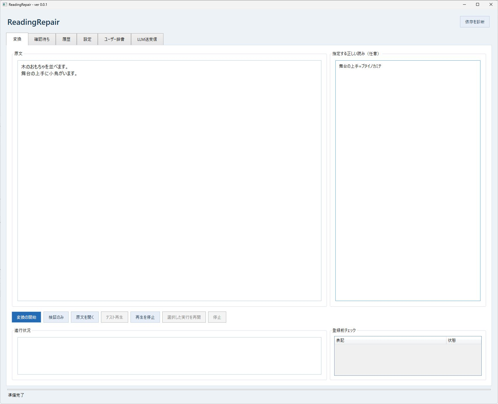
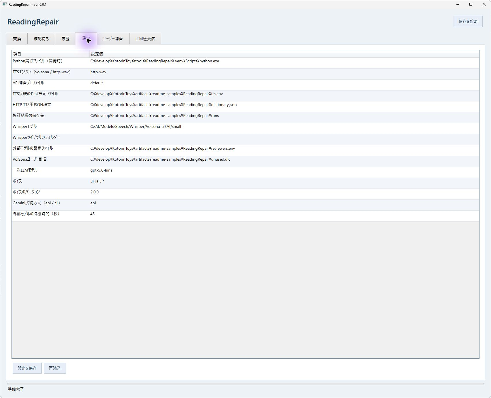
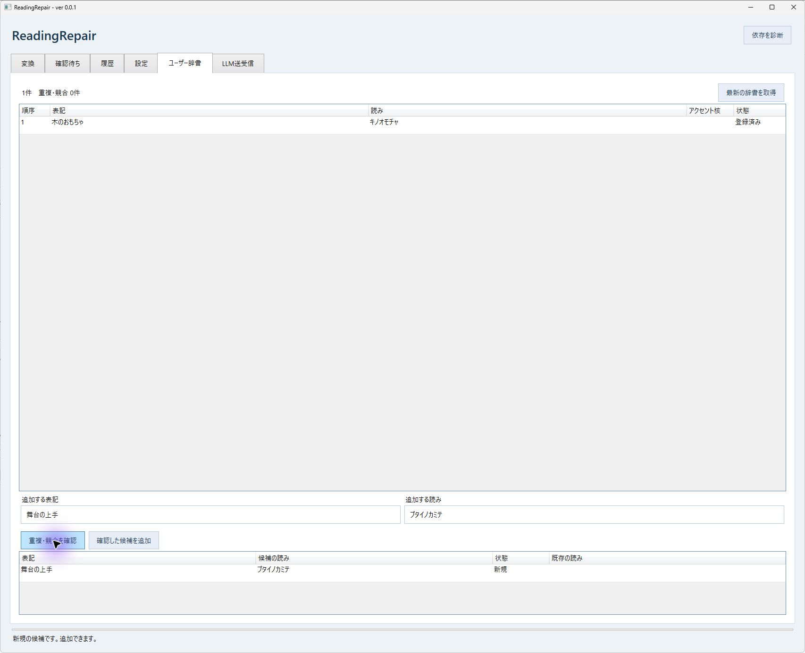
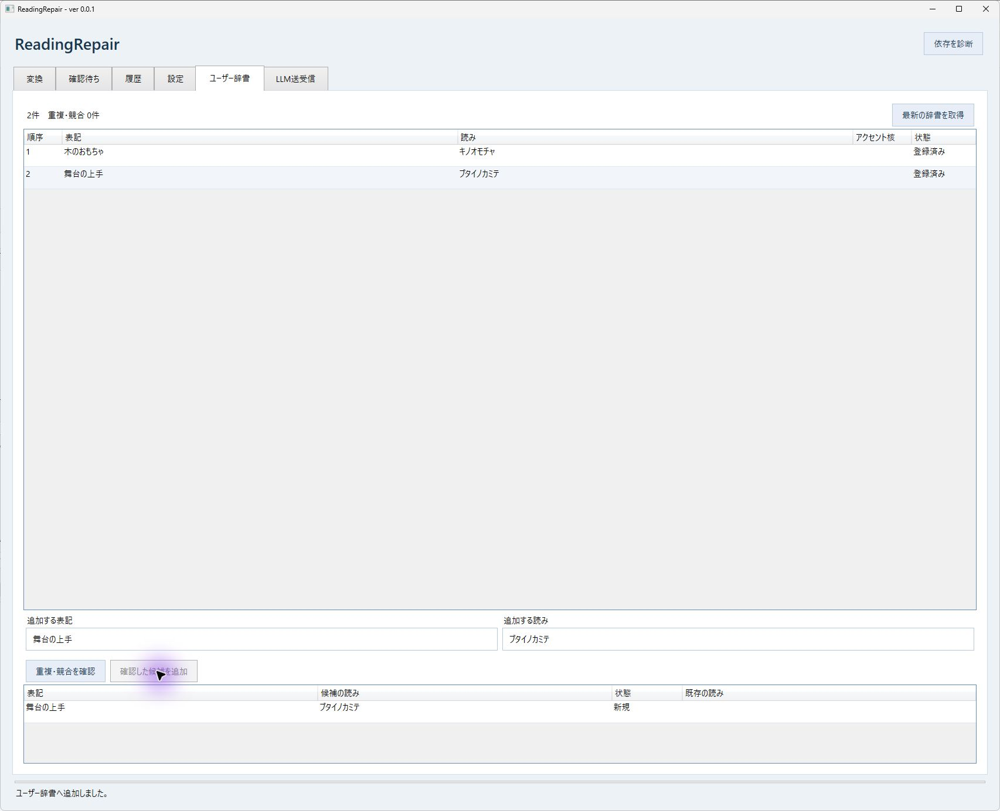
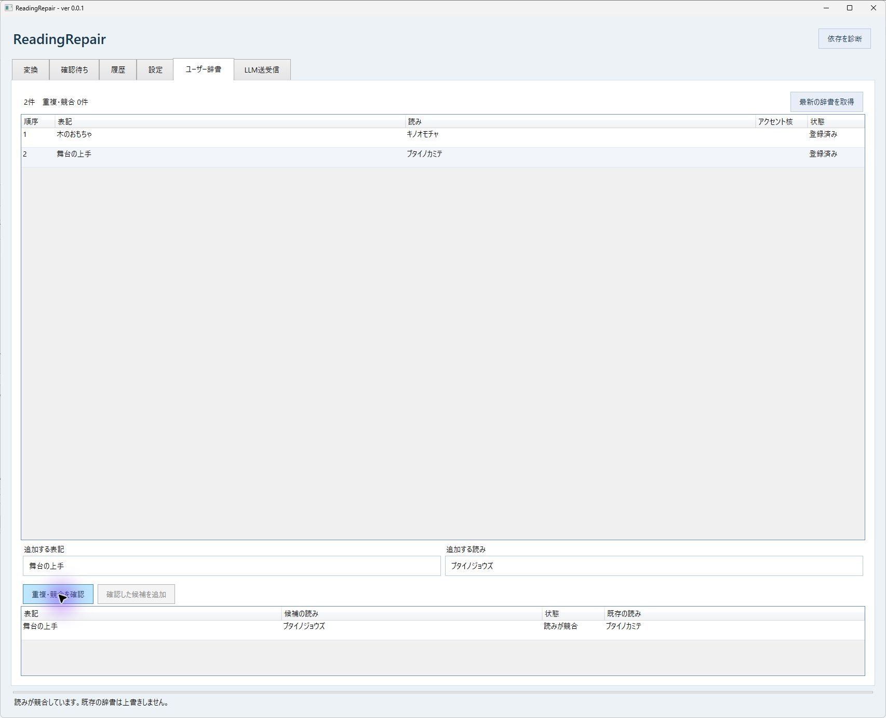

# ReadingRepair

日本語TTSの読みを検証し、ユーザー辞書と音声を改善するWindowsアプリです。VoiSona Talkと、JSONを受け取りWAVを返すHTTP音声APIに対応します。

[最新版をダウンロード](https://github.com/KotorinChunChun/ReadingRepair/releases/latest)して、インストーラーを実行するかZIPを展開して`ReadingRepair.exe`を起動します。Pythonと.NETの実行環境を同梱しています。GitHubへのログインなしでダウンロードできます。KotorinToysの一覧からも導入できます。初期設定にはPowerShell 7、ログイン済みCodex CLI、ローカルWhisperモデル、使用するTTSの設定が必要です。

**初めて使う場合は[初回設定とCLI実行](docs/first-run.md)から進めてください。** Whisperのライブラリは同梱していますが、モデル本体は別途取得が必要です。ボイスの名前・版、接続用.env、辞書の保存先も確認します。v0.0.2以降には、モデル取得用`Install-WhisperModel.ps1`と新規空辞書用`Initialize-VoisonaDictionary.ps1`を同梱しています。既存モデル・辞書は上書きしません。

原文を入力して「変換の開始」を押すと、音声生成、Whisper文字起こし、複数モデルの読み比較、辞書登録、音声再生成、前後評価まで進みます。判断が分かれた語は確認待ちになり、各行から採用・不採用を選べます。完了後は「テスト再生」で音声を確認できます。

設定・履歴は`%LOCALAPPDATA%/ReadingRepair`へ保存します。認証情報はソース外の`.env`で指定します。原文の必要な文脈と未確定語を設定したLLMへ送信します。登録済み辞書の全件テーブルは送信しません。自動評価は人間の聴取による正解保証ではありません。

- [使い方・CLI](docs/guide.md)
- [初回設定・モデル取得・失敗後の再開](docs/first-run.md)
- [暫定共有辞書・登録時点の記録](dictionaries/engineer-exam/2026-11-05/README.md)
- [TTS APIの接続・拡張](docs/tts-engines.md)
- [開発・ビルド・検証](docs/development.md)
- [ライセンス](LICENSE)

## 画面で見る使い方

以下は0.0.1の画面です。架空の原稿と専用のHTTP TTS辞書を使っています。音声APIやLLMへ接続した結果ではありません。

### 1. 原文を入力する

「変換」で文章を入力します。読みが決まっている語句は右側へ `表記=カタカナ読み` で指定できます。「検証のみ」は辞書に登録する前で止まります。

### 2. 使用するエンジンを設定する

「設定」でTTSエンジン、辞書、モデル、保存先を指定して保存します。画像のパスは撮影専用の例です。実際には自分の環境に合わせてください。APIキーは外部設定ファイルに保管します。

### 3. 辞書候補を確認する

「ユーザー辞書」で表記と全角カタカナの読みを入力し、「重複・競合を確認」を押します。文脈で変わる読みは「上手」だけでなく「舞台の上手」のように指定します。

### 4. 確認した候補を登録する

「新規」と表示された候補は「確認した候補を追加」で登録できます。上の一覧と下部の完了表示を確認してください。辞書登録だけでは原文の音声は再生成されません。

### 5. 読みの競合を確認する

既存の表記に異なる読みを指定すると「読みが競合」となり、追加ボタンは押せません。表示された既存の読みを確認し、語句を限定するか候補を修正します。

