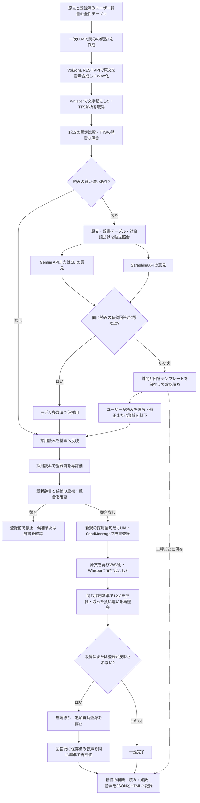

# VoiSona 読み自己修復アプリ

一次LLMの読みの仮説（1）を、VoiSonaの音声合成WAV→Whisper文字起こし（2）と比較します。TTS解析の発音差も照合し、食い違う語はGemini（直接APIまたはCLI）とSarashinaAPIへ独立して問い合わせます。一次LLMを含む有効回答で同じ読みが2票以上あれば多数決で仮採用し、利用者の回答があればそちらを優先します。登録前後は同じ採用基準で評価します。本体アプリの録音・会話への統合はありません。

## Windowsアプリの起動

```powershell
pwsh -File .\tools\PronunciationDictionaryLab\Start-ReadingRepair.ps1
```

初回は.NET 10 SDKで画面と登録ヘルパーをビルドします。準備済みなら`-NoBuild`で起動できます。実行ファイルは`tools/PronunciationDictionaryLab/Desktop/bin/ReadingRepair/Debug/net10.0-windows/VoisonaReadingRepair.exe`です。このPCの既存Python 3.12・Whisper・Codex CLI・VoiSona Talkを使います。配布用インストーラーではなく、現在の作業フォルダーで使用する独立アプリです。

1. 「依存を診断」でVoiSonaのREST API、辞書、Python、Whisper、一次LLMを確認します。外部モデルの項目はキー設定の有無であり、実通信の成功とは区別します。
2. 「自己修復」に原文を入力します。正しい読みが分かっている語句は任意欄へ`舞台の上手=ブタイノカミテ`のように1行ずつ指定できます。
3. 「変換の開始」は音声合成から、採用条件を満たした候補の登録と再評価まで行います。「検証のみ」は登録前で停止します。同じ読みが有効な2票以上で一致しなければ確認待ちです。照会失敗・未設定・判断不能のモデルは票に数えません。残り2票が一致すれば仮採用できます。
4. 「確認待ち」で原文の文脈・一次LLMの仮説・TTSの発音・外部モデルの意見を確認します。候補一覧の各行に表示した読みを「採用」、または「不採用」で1クリック保存できます。別の読みや登録語句を指定するときは詳細欄を編集し、理由とともに保存します。「回答を反映して再開」で保存した同じ実行を再開します。
5. 「履歴」から実行を選ぶと、前後の点数、音声、HTMLを確認できます。検証のみの結果から実際に適用する場合は「候補を適用して再開」を押します。音声は再生ボタンを押したときだけデバイスへ再生します。

開始画面の「テスト再生」は、処理が停止していて生成済み音声があるときに有効になります。登録後の音声を優先し、登録後がなければ登録前の音声を再生します。「再生を停止」で止められます。

各ボタンのツールチップには、機能・押した後の動作・保留する条件を表示します。回答の保存だけでは登録・再生成は始まりません。全候補への回答後に「回答を反映して再開」を押してください。「検証のみ」の履歴は登録前で止まるため、続いて「候補を適用して再開」で登録と再生成へ進みます。

「進行状況」には全文の読み、語句ごとのTTS発音、Whisper本文、食い違いの根拠、モデルの応答・障害、採用理由、登録内容と前後の評価を逐次表示します。確認待ちや検証のみで止まる場合も理由と次の操作を記録します。履歴を選び直すと保存済みログを表示し、再開時は旧ログを残して追記します。各実行フォルダーの`progress.log`は文章、`progress.jsonl`は機械可読の同じ経緯です。過去の履歴は工程JSONから復元します。

「確認待ち」の一次LLM欄には実際のモデル名を表示します。「VoiSonaの発音」はTTS解析から対象語へ対応づけた発音で、Whisperの文字起こしとは別です。数値の1→一など、別の語の表記変換があっても後続の一致部分を照合します。対応づけできない場合は未確定の理由を表示し、Whisperの実施有無と本文も別に表示します。有効票と棄権の理由も確認できます。

「LLM送受信」は選択した実行の呼び出しごとのモデル・工程・状態・送信プロンプト・応答を読む専用画面です。新しい呼び出しは`llm/calls/<呼出ID>/`に追記し、再試行前の送受信も保持します。一次LLMは受信した本文、外部モデルは受信応答を解析したJSONを表示します。HTTP失敗は状態コードとエラー種別のみで、生のHTTPエラー本文や認証ヘッダーは保存しません。旧記録の保存済みプロンプトや、入力JSONからの復元はその旨を区別します。無効・キー未設定は未送信として表示します。

詳細ログ追加後の[検証履歴](../dev/history/v0.4.0/logs/reading-repair-progress-20261103/report/index.html)には、実CLIの詳細イベントとモデル送受信も収録しています。今回の人工文の実照会はGemini 503・Sarashina判断不能で有効1票のため保留し、2票の仮採用が成立したとは記録していません。多数決の各分岐は外部へ送らない自動試験で確認しています。

改行や空行を含む原文も入力できます。保存・照合では改行をLFへ統一し、文章自体の変更は検出します。旧不具合で開始直後に「保存された原文が変更されています」と表示された履歴は、元のハッシュと一致する内容を復元できる場合、同じ実行を再開できます。

「ユーザー辞書」には起動時の現在の辞書を全件表示し、順序・表記・読み・アクセント核・既存の重複や競合を確認できます。「最新の辞書を取得」で再読込します。追加する表記と読みを入力して「重複・競合を確認」を押すと、新規の場合だけ「確認した候補を追加」が有効になります。入力を変更すると確認結果を無効化します。既登録は追加せず、競合を上書きしません。確認後に辞書が変わった場合も再確認が必要です。

自己修復の登録計画にも同じ事前チェックを行い、「登録前チェック」へ結果を表示します。候補の後半に競合があっても、先に登録を始めません。複数件の途中まで登録した後の外部変更や障害は、台帳を保持して止まり、再開時に最新辞書を確認します。

「停止」は現在の処理の安全な区切りで反映します。LLM・HTTP等の処理中は最大で設定済みの待機時間がかかります。完了済みの工程と登録済み項目は保持し、停止・失敗・中断した実行を再開できます。同じ辞書への別の実行はOSロックで防止します。

設定は`%LOCALAPPDATA%\VoisonaReadingRepair\settings.json`へ保存し、キーそのものは保存しません。診断や試験用の別設定は起動スクリプトの`-SettingsFile <JSON>`で指定できます。結果の既定先はこの作業フォルダーの`dev/history/v0.4.0/logs/`です。

アプリではGeminiの直接APIを既定にしています。`gemini_transport`を`cli`にすると既存のCLI方式も使用できます。キーとモデルは外部.envで管理します。照会設定を変更後に「モデル照会を再試行」すると照会用設定のみ更新し、原文・一次LLM・Whisper・ボイスは固定します。

## アプリ共通CLI

このPCでは次の入口で、PythonのPATH変更やGUI起動なしに操作できます。`-Build`は両プロジェクトをビルドして診断し、画面は開きません。

```powershell
pwsh -File .\tools\PronunciationDictionaryLab\Invoke-ReadingRepair.ps1 doctor -Build
pwsh -File .\tools\PronunciationDictionaryLab\Invoke-ReadingRepair.ps1 create -TextFile <原文ファイル> -Mode repair
pwsh -File .\tools\PronunciationDictionaryLab\Invoke-ReadingRepair.ps1 execute -Job <実行ID>
pwsh -File .\tools\PronunciationDictionaryLab\Invoke-ReadingRepair.ps1 status -Job <実行ID>
pwsh -File .\tools\PronunciationDictionaryLab\Invoke-ReadingRepair.ps1 answer -Job <実行ID> -RequestFile <回答JSON>
pwsh -File .\tools\PronunciationDictionaryLab\Invoke-ReadingRepair.ps1 execute -Job <実行ID> -RetryReviewers
pwsh -File .\tools\PronunciationDictionaryLab\Invoke-ReadingRepair.ps1 stop -Job <実行ID>
```

設定は`-SettingsFile`、検証済み候補の適用は`-Apply`、音声再生は`audio -Phase after -Play`を指定します。以下のPython CLIと同じ処理です。

画面を使わず同じ処理を実行できます。各操作の最後は`type=result`のJSON、失敗時は`type=error`を返します。`execute`中は工程のJSONも順に出力します。

```powershell
$repairCli='.\tools\PronunciationDictionaryLab\application.py'
python $repairCli doctor
python $repairCli create --text-file .\tools\PronunciationDictionaryLab\sample.txt --mode repair
python $repairCli execute --job <作成された実行ID>
python $repairCli status --job <実行ID>
python $repairCli history
python $repairCli answer --job <実行ID> --request <回答JSON>
python $repairCli execute --job <実行ID> --retry-reviewers
python $repairCli stop --job <実行ID>
python $repairCli audio --job <実行ID> --phase after --play
python $repairCli export --job <実行ID>
python $repairCli log --job <実行ID>
python $repairCli llm-log --job <実行ID>
```

`create --request`では`{"text":"原文","mode":"repair","known_readings":[{"surface":"語句","reading":"カタカナ"}]}`を指定できます。`answer --request`は`{"answers":[{"id":"候補ID","action":"accept","reading":"カミテ","reason":"舞台用語","registration":{"surface":"舞台の上手","reading":"ブタイノカミテ"}}]}`です。`reject`ならreading・registrationは不要です。`--stdin`で同じJSONを標準入力から渡せます。設定の取得は`settings`、変更は`save-settings --request <JSON>`です。全コマンドで`--settings <JSON>`を共通に指定できます。

検証のみの候補を適用するCLIは`execute --job <ID> --apply`です。既知の読みや回答が指定されていても、既存の異なる辞書項目を勝手に上書きしません。英数字はVoiSonaが全角保存するため表記の幅だけを照合し、丸数字①と数字1は同じ扱いにしません。

辞書の操作もGUIと同じCLIで行えます。

```powershell
pwsh -File .\tools\PronunciationDictionaryLab\Invoke-ReadingRepair.ps1 dictionary
pwsh -File .\tools\PronunciationDictionaryLab\Invoke-ReadingRepair.ps1 check-dictionary -RequestFile <候補JSON>
pwsh -File .\tools\PronunciationDictionaryLab\Invoke-ReadingRepair.ps1 add-dictionary -RequestFile <確認済み候補JSON>
```

候補JSONは`{"entries":[{"surface":"舞台の上手","reading":"ブタイノカミテ"}]}`です。追加時は確認結果の`dictionary_sha256`も同じJSONの直下に付けます。CLIのJSONには新規・登録済み・候補内重複・競合の状態を返し、登録直前に最新辞書でも再確認します。新規候補だけが既存UIAヘルパーへ渡ります。手動追加の台帳は結果保存先の`dictionary-additions-<日時>-<ID>/`へ保存します。

改行修正後の[CLI検証履歴](../dev/history/v0.4.0/logs/reading-repair-newlines-20261103/report/index.html)には、CRLFと空行を含む原文の実音声生成・文字起こし・100→100点の評価を追加しています。現在辞書33件の取得、既登録・競合・確認後変更で書込みを止めることもCLIで検証しました。

## このPCでの検証結果（2026-11-03）

Python 87件・登録ヘルパー4件、両プロジェクトのビルドと実VoiSonaの一巡、CLIの停止・再開・音声情報・履歴出力を確認しました。既存辞書を使った原文は100→100点、新規登録0件です。Sarashinaの実API応答は取得でき、Gemini生成はHTTP 503でした。Geminiを使った合意を必要とする候補は、応答を得られるまで確認待ちになるか、利用者が読みを回答します。

音声入りの[一連の検証履歴](../dev/history/v0.4.0/logs/reading-repair-app-20261103/report/index.html)と[機械検査の結果](../dev/history/v0.4.0/logs/reading-repair-app-20261103/final-validation.json)は、この作業フォルダーのGit対象外の実行記録です。音声生成・自動比較と、人間の聴取による正解確認は区別しています。

## 処理のフローチャート



モデル多数決による仮採用は、人間による正解認定と区別します。一次LLMと外部モデルの1票ずつでも、外部2モデルの2票でも、同じ読みであれば仮採用します。Whisperだけが食い違い、TTS解析の発音と基準が一致する場合は辞書登録を行いません。登録後の回答では保存済み音声を再評価し、自動登録を繰り返しません。登録済みの採用判断そのものを変える場合は新しい試行で検証します。

## 実行

VoiSona Talkを起動し、雨衣2.0.0とREST APIを有効にしてください。ProjectRootは既存の`.env`と`src/CodexChat.psm1`があるフォルダーです。Python 3.12とfaster-whisper 1.2.1、ローカルsmallモデル、ログイン済みCodex CLIを使用します。

```powershell
dotnet build .\tools\PronunciationDictionaryLab\Registration\Registration.csproj -p:NuGetAudit=false
pwsh -File .\tools\PronunciationDictionaryLab\Start-Lab.ps1 -ProjectRoot C:\develop\VoisonaTalkAI -Apply
```

別のsite-packagesにfaster-whisperがある環境では`-WhisperSitePackages <既存Lib\site-packages>`を追加します。既存venvの起動パスが旧PCを参照する場合にも、現在のPython 3.12からライブラリだけを読み込めます。モデルをダウンロードする処理はありません。

`-Apply`を付けると裁定で採用された候補を登録し、登録後の評価まで進みます。キー未設定・モデル間の相違・不確実な意見では`-Apply`があっても登録前に確認待ちになります。付けない場合は候補作成まで、`-PrepareOnly`も候補作成までです。同じ条件で再開するには同じ`-RunDirectory`に`-Resume -Apply`を付けます。原文・モデル・ボイス・入力形式が異なる旧試行は再開できません。

### 外部モデルの設定

実際に記入するテンプレートは`C:\AI\env\voisona-reading-review.env`です。`GEMINI_API_KEY`と`SARASHINA_API_KEY`を記入してください。Gemini CLIは別途インストール済みである必要があります。`GEMINI_CLI_PATH`はコマンド名または実行パス、`GEMINI_MODEL`が空ならCLIの既定モデルを使います。Sarashinaは`SARASHINA_BASE_URL`と`SARASHINA_MODEL`を変更できます。

配布用の空テンプレートは[reviewers.env.example](../tools/PronunciationDictionaryLab/reviewers.env.example)です。実設定が存在する場合は上書きしません。別の設定は`-ReviewerEnv <ファイル>`で指定します。キー・HTTP例外本文・CLIのエラー出力は履歴へ保存せず、各キーは該当プロバイダーにだけ渡します。Geminiは一時ホーム・MCPなし・ツール実行禁止で照会します。一次LLMは既存のCodex認証を使います。

Gemini CLIの信頼確認は、この処理が作成した空の一時フォルダーだけをプロセス内で信頼対象にします。通常の信頼フォルダー設定を変更しません。タイムアウト時はCLIの自己再起動・中継の子プロセスも含めて終了させます。

キー未設定は`not_configured`、無効化は`disabled`、通信・起動・応答検証の失敗は`unavailable`として記録します。設定後は`-Resume -RetryReviewers`で再照会できます。外部モデルには他モデルの読み・比較結果を見せず、原文・登録済み辞書の全件テーブル・対象語だけを渡します。

外部照会の契約は[Geminiのヘッドレス実行](https://geminicli.com/docs/cli/headless/)、[設定項目](https://geminicli.com/docs/reference/configuration/)、[ポリシー](https://geminicli.com/docs/reference/policy-engine/)、[SarashinaのChat Completions](https://docs.sarashina.ai/api-reference/chat-completions)を参照します。実接続はキー設定後に別途確認します。

### ユーザー回答で再開

確認待ちになると試行フォルダーに`confirmation-questions.json`と`answers-template.json`が作成されます。登録後は`post-`付きです。テンプレートを別名へコピーし、実際の回答を各行の`action`（`accept`または`reject`）、採用する場合の`reading`（全角カタカナ）、判断の`reason`へ記入します。空の`action`は未回答です。候補IDと原文ハッシュは変更しません。

```powershell
pwsh -File .\tools\PronunciationDictionaryLab\Start-Lab.ps1 -ProjectRoot C:\develop\VoisonaTalkAI -RunDirectory <同じ試行フォルダー> -Resume -Apply -AnswersFile <回答JSON>
```

未回答の質問が残る場合は停止を維持します。回答で基準が変わった場合、保存済みWAVの文字起こしを同じ新基準で再評価し、旧点数を削除しません。適用前の回答変更では登録計画を更新します。登録完了後に採用判断が変わる場合は新しい試行先を指定します。`reject`は辞書登録の却下であり、全文の基準読みを確定したことにはしません。

### 文脈を含むまとまりで登録

多義語は短い単語だけで登録すると他の文脈も変わります。回答の`reading`は対象語の読み、任意の`registration`は実際に登録する原文内の語句とその全体の読みです。例えば「舞台の上手」については次のように指定します。

```json
{
  "action": "accept",
  "reading": "カミテ",
  "reason": "舞台の位置を表す用法だけに限定する",
  "registration": {"surface": "舞台の上手", "reading": "ブタイノカミテ"}
}
```

登録計画には「舞台の上手」のみを渡し、「上手＝カミテ」の一律登録をしません。評価基準も承認された語句全体へまとめます。語句の外にも現れる同じ短語は別の評価単位として保ちます。語句は原文内にあり、対象語と採用読みを含むことを検査します。`registration`を省略した従来の回答形式も使用できます。

### LLMへ添付する登録済みユーザー辞書

基準読み・比較・登録計画と外部2モデルの各LLM入力に、既存のユーザー辞書の**全件テーブル**を添付します。列は「優先順位・表記・読み・アクセント核」です。原文に出現しない語や同表記の複数登録も省略せず、登録順を保ちます。同表記では上の行を優先します。ユーザーが別読みを採用した場合は、その明示的な判断を優先します。登録語の省略・読みの相違も裁定対象へ加えます。

登録前のテーブルは`known-readings.json`、登録後の更新済みテーブルは`registered-readings.json`に保存します。LLMへ送った実際の入力文にもテーブルを記録し、HTML履歴でも表として読めます。認証設定は添付しません。

Whisperの文字起こしに辞書の表記が存在する場合は、その語の解釈に辞書を使います。文字起こしが別のカナ・数字・単語になっている場合は、辞書や原文に合わせて正解へ修復せず、誤読の証拠を残すよう指示しています。Whisper自身への正解ヒントは追加していません。

全件テーブル添付前の履歴と新しいLLM入力を混在させないため、実行条件に入力形式の識別子を保存します。旧形式の試行に`-Resume`を指定すると、過去の結果を変更せず新しい保存先を案内します。

## 辞書の登録

音声合成・TTS解析はREST API、WhisperはPython、モデル照会はAPI/CLI、記録はファイル処理です。GUIが必要なのは辞書登録だけです。再利用Skillの`voisona-reading-validation`からも既存CLIを呼び出し、登録やAPI処理はSkill内へ複製しません。

登録はC#のUIAヘルパーが行います。VoiSonaの辞書リストをGridPattern、表記・発音欄をラベルとTextPatternで特定し、SendMessageTimeoutで文字入力と確定を送ります。固定画面座標やスクリーンショット認識に依存しません。既存と同じ読みはスキップし、異なる読みは競合として停止します。登録前後の辞書を退避し、既存項目が保たれていることを検査します。辞書ファイルを外部から編集する方式ではありません。

原文に存在する採用済みの最大100語を、20件ずつ分割して登録します。同じ表記で文脈により読みが異なる語は一律登録しません。登録の台帳は各試行フォルダーの`registration.json`と各試行の台帳です。試験後も登録した語は残ります。

## 評価と記録

標準の出力先は`dev/history/v0.4.0/logs/dictionary-lab-<日時>/`です。原文、基準読み、LLM入出力、前後のWAV、Whisperの全文・区間、TTS解析、候補と登録計画、辞書退避、処理時間を保存します。認証情報は保存しません。架空の検証文で試し、ユーザーの実会話を試験出力へ混入させないでください。

- `manifest.json`: 到達段階・実行条件・失敗・再開状態。
- `comparison-1-2.json` / `comparison-1-3.json`: LLMの0～100点、正規化カナの編集距離・CER・一致率、誤読候補。
- `summary.json`: 前後の点数・CER差分と登録結果。
- `secondary-review.json` / `adjudication.json`: 外部モデルの状態・意見と採用・却下・保留理由。登録後は`post-`付き。
- `reference-adopted.json` / `comparison-adopted-before.json`: 採用読みと登録前の再評価。
- `reference-final.json` / `comparison-final-before.json` / `comparison-final-after.json`: 同じ最終基準による前後評価。
- `decision-history/`: 変更前の判断・基準・点数。質問は`confirmation-questions.json`、空の回答書式は`answers-template.json`。

### 工程ごとのHTML履歴

各実行は停止・完了時に`report/index.html`と`history.json`を生成します。保存済みの複数回の検証を、指定した順に一つのHTMLとJSONへまとめられます。合成・LLM・Whisper・辞書登録は再実行しません。

```powershell
python .\tools\PronunciationDictionaryLab\export_history.py --run .\dev\history\v0.4.0\logs\dictionary-lab-trial-01 --run .\dev\history\v0.4.0\logs\dictionary-lab-trial-02 --notes .\dev\history\v0.4.0\logs\dictionary-lab-history-20261026\notes.json --output .\dev\history\v0.4.0\logs\dictionary-lab-history-20261026
```

出力の`index.html`には、フローチャート、工程ごとの文章、LLM入出力、採用判断と質問、基準読み、文字起こし、登録候補、前後の評価値と音声を埋め込みます。旧評価も取り込み、採用未確定の点数は暫定評価と表示します。HTML単独で本文・元データ・音声を読めます。同じ内容を構造化した`history.json`も生成します。外部JavaScript・画像・フォントへは接続しません。

改善の理由は任意の`--notes`で補足します。形式は`{"trials":{"実行フォルダー名":{"title":"試行名","paragraphs":["改善理由の文章"]}},"findings":[{"title":"判明した問題","text":"内容"}]}`です。注記は生成データと分けて保持し、実施していない工程は記録なし・未実施と表示します。取り込むファイルは明示した工程のJSON・文章・音声に限定し、認証設定や辞書全体のバックアップは含めません。

原文と音声のSHA-256を実行記録と照合し、不一致なら生成を停止します。取り込み元ごとのハッシュも履歴に残します。生成結果は対象版のlogs内に置き、Git対象外にします。

CERは採用基準のカナ文字数に対する編集距離です。LLMの点数とは別の指標です。既存辞書の読みを基準生成へ渡しますが、Whisperには原文や正解をヒントとして渡さず、同じ認識条件で比較します。Whisperが漢字へ補正した場合は誤読を見逃せるため、TTS解析の発音差も候補に加えます。100点でも誤読ゼロを保証せず、人間の聴取・アクセント・音程の評価ではありません。

初回実験では「四月一日 → ワタヌキ」を登録できましたが、「舞台の上手」はTTS解析でジョーズのままでも、Whisperが「上手」と出し、LLMがカミテと解釈して見逃しました。旧実験の84→100点は当時の基準で保持します。今回の方式は一次LLMだけで登録を断定しません。`summary.json`の`auxiliary_talk_literal_differences`には長音等の表記差を含む補助記録も残します。

## 自動検証

```powershell
python -m unittest discover -s .\tools\PronunciationDictionaryLab -p "test_*.py"
```

模擬サービスでモデル一致、意見相違、キー未設定、回答再開、同一採用基準での評価、登録不反映時の停止を確認します。模擬結果は実APIの認証成功や実際のユーザー回答と区別します。
